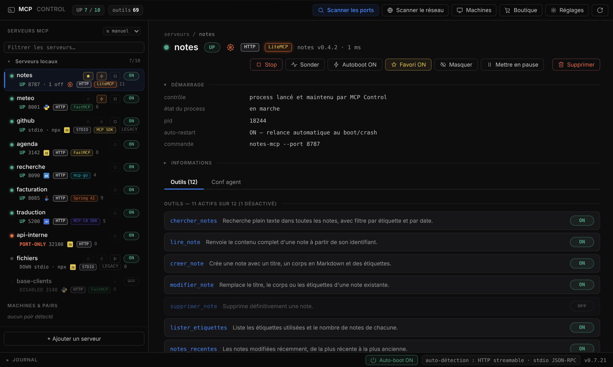

# MCP Control

**Le tableau de bord de tes serveurs MCP.** Il les trouve tout seul, te dit lequel marche et lequel est cassé (et pourquoi), et tout se pilote d'un clic. Ton assistant IA peut aussi s'y brancher et faire ces gestes à ta place.


[Installer](#installer) · [Premiers pas](#premiers-pas) · [Les 4 états](#comprendre-létat-dun-serveur) · [Ce que tu peux faire](#ce-que-tu-peux-faire) · [Brancher ton assistant IA](#brancher-ton-assistant-ia-pont-stdio-mcp-control-bridge) · [Appairer une autre machine](#appairer-une-autre-machine-tls-13--code-6-chiffres) · [Dépannage](#dépannage) · [Sécurité](#sécurité-avancé) · [Limites](#limites) · [Migration 0.8](docs/migration-0.8.md) · [Développeurs](#pour-les-développeurs)

## En bref

- **Voir** tous tes serveurs MCP au même endroit, même ceux que tu avais oubliés : l'app balaie les ports de ta machine et reconnaît 38 frameworks.
- **Savoir** tout de suite qui répond, qui est planté, et pour quelle raison.
- **Agir** : démarrer, arrêter, relancer automatiquement, couper un outil précis, installer un nouveau serveur depuis la boutique.
- **Déléguer** : l'app est elle-même un serveur MCP. Un assistant qui s'y connecte peut lister, relancer, installer et appeler les outils de tes serveurs.

Windows, macOS et Linux. Rien à configurer, aucun compte.

## Installer

Télécharge le fichier de ton système sur la [page des releases](https://github.com/DeamonDev888/mcp-control/releases/latest) :

| Système | Fichier |
|---|---|
| **Windows** (installateur) | [`mcp-control-desktop-windows-x86_64-setup.exe`](https://github.com/DeamonDev888/mcp-control/releases/latest/download/mcp-control-desktop-windows-x86_64-setup.exe) |
| **macOS** (Intel et Apple Silicon) | [`mcp-control-desktop-macos-universal`](https://github.com/DeamonDev888/mcp-control/releases/latest/download/mcp-control-desktop-macos-universal) |
| **Linux** (x86_64) | [`mcp-control-desktop-linux-x86_64`](https://github.com/DeamonDev888/mcp-control/releases/latest/download/mcp-control-desktop-linux-x86_64) |

- **Windows** : l'installateur ne demande aucun droit administrateur.
- **macOS** : au premier lancement, clic droit sur le fichier → **Ouvrir**.
- **Linux** : `chmod +x` sur le fichier, puis lance-le.
- **Sans fenêtre** : les binaires `mcp-control-cli-*` de la même release lancent seulement le moteur ; l'interface s'ouvre alors dans ton navigateur sur `http://127.0.0.1:5090`.

<details>
<summary><b>Windows affiche « application non reconnue » ?</b></summary>

Les binaires ne sont pas encore signés : SmartScreen ne connaît pas l'éditeur. Trois façons de passer :

1. À l'avertissement : **Informations complémentaires → Exécuter quand même** (une fois par version).
2. Avant de lancer : `Unblock-File .\mcp-control-desktop-windows-x86_64-setup.exe` dans PowerShell.
3. Vérifier le fichier, puis lancer :

```powershell
Get-FileHash .\mcp-control-desktop-windows-x86_64-setup.exe -Algorithm SHA256
# à comparer avec la ligne du même fichier dans SHA256SUMS.txt :
# https://github.com/DeamonDev888/mcp-control/releases/latest/download/SHA256SUMS.txt
```

</details>

## Premiers pas

1. Ouvre l'app. La liste se remplit toute seule.
2. Clique sur un serveur pour voir ses outils, son état, sa version et sa latence.
3. Un serveur manque ? Clique **⟳** (re-sonde tout et cherche sur tous les ports en écoute), ou **+ Ajouter un serveur**.



Fermer la fenêtre ne quitte pas l'app : elle reste dans la zone de notification et continue de surveiller. Pour quitter vraiment : menu de son icône → **Quitter**.

## Comprendre l'état d'un serveur

L'app ne dit pas seulement « ça marche » ou « ça ne marche pas ». Chaque serveur a l'un de ces quatre états :

| État | Le port | Le serveur MCP | Ce que ça veut dire | Quoi faire |
|---|---|---|---|---|
| 🟢 **UP** | ouvert | répond | le dialogue MCP complet a réussi, les outils sont listés | rien |
| 🟠 **PORT-ONLY** | ouvert | ne répond pas | quelque chose écoute sur ce port, mais ne parle pas MCP | trouver qui occupe le port, ou retirer le serveur |
| ⚪ **DOWN** | fermé | ne répond pas | le serveur est arrêté ou a planté | **▶** pour le relancer |
| ⚫ **DISABLED** | — | — | tu l'as mis en pause : l'app ne le sonde plus | **▶ Reprendre** |

PORT-ONLY et DOWN n'appellent pas le même geste, d'où la distinction. Un serveur DOWN se relance. Un serveur PORT-ONLY ne redémarrera pas tant que le port est pris, souvent par un process resté en vie ou par un service qui n'a rien à voir. Le motif exact s'affiche en tête du détail :


À côté du nom, trois badges : le **langage** (logo), le **transport** (`HTTP`, `STDIO`, `WS`) et le **framework** reconnu (`FastMCP`, `LiteMCP`, `rmcp`, `mcp-go`, `Spring AI`…). La liste des 38 frameworks est dans [docs/frameworks.md](docs/frameworks.md).

L'app sonde les serveurs à l'intervalle réglé dans **Réglages → Général** (15 s par défaut, 5 s au minimum). Un serveur lent ou muet ne retarde pas les autres.

<details>
<summary><b>Reproduire les quatre états chez soi</b></summary>

```bash
# UP : un vrai serveur MCP
node examples/test-http-server.js 3166

# PORT-ONLY : un port qui répond, mais pas en MCP
node -e "require('http').createServer((q,s)=>s.end('ok')).listen(32100)"

# DOWN : ajoute un serveur sur le port 32101 et ne le démarre pas
# DISABLED : « Mettre en pause » dans le détail d'un serveur
```

</details>

## Ce que tu peux faire

**Trouver des serveurs**

| Bouton | Effet |
|---|---|
| **⟳** | Re-sonde tout et cherche les nouveaux serveurs sur les ports en écoute |
| **Scanner les ports** | Cherche sur une plage de ports (512 ports au plus par scan) |
| **Scanner le réseau** | Cherche sur les autres machines du réseau local |
| **Machines** | Va chercher les serveurs d'une machine distante par SSH, et détecte les autres MCP Control du réseau |
| **+ Ajouter un serveur** | Ajout à la main, ou collage d'un bloc `mcpServers` ou d'une URL |
| **Boutique** | 63 serveurs MCP prêts à installer |


**Piloter un serveur**

| Bouton | Effet |
|---|---|
| **ON / OFF** | Allumer ou éteindre le serveur |
| **▶ / ■** | Démarrer ou arrêter son programme |
| **⚡ Autoboot** | Le relancer au démarrage de l'app et après un crash |
| **⭐ Favori** | L'épingler en haut de la liste |
| **Mettre en pause** | Le sortir de la surveillance sans le supprimer |
| **Supprimer** | Le retirer de la liste |
| Interrupteur d'un outil | Couper un outil précis sans arrêter le serveur |

**Organiser et régler**

- **Filtre** (`/` ou `Ctrl+K`) : par nom, port, framework ou état. `Échap` efface.
- **Tri** : manuel (glisser-déposer), A→Z, état, port, latence, outils, framework, transport.
- **Journal** (barre du bas) : l'historique de ce qui s'est passé.
- **Auto-boot** (barre du bas) : ouvrir l'app au démarrage de l'ordinateur, réduite dans la zone de notification.
- **Réglages** : intervalle de sondage, plages de scan, accès réseau, notifications (bureau et webhook), thème, réinitialisation.


## Brancher ton assistant IA (pont stdio `mcp-control bridge`)

L'app expose un serveur MCP complet sur `POST /mcp` (propulsé par [LiteMCP](https://github.com/DeamonDev888/litemcp) 0.12.0). Depuis la **0.8.0**, chaque requête sur `/mcp` est signée en **Ed25519** (RFC 9421 + RFC 9530) — y compris en local.

Pour brancher un assistant IA sans écrire de code de signature, utilise l'appairage puis le pont stdio **`mcp-control bridge`** :

### 1. Appairer l'assistant (une seule fois)

```bash
mcp-control auth pair http://127.0.0.1:5090 --label "Claude"
```

1. Un **code de vérification à 6 chiffres** s'affiche dans le terminal.
2. Ouvre MCP Control → **Accès → Appairage**, vérifie le code à 6 chiffres, choisis les droits (`lecture`, `pilotage`, `execution`) et clique **Approuver**.
3. La clé privée est enregistrée dans le trousseau du système (ou en fichier `0600` / ACL utilisateur en repli) et l'identité du serveur est épinglée.

### 2. Ajouter le bloc JSON dans ton assistant

**Claude Desktop** (`claude_desktop_config.json`), **Claude Code** (`.mcp.json`) ou **Cursor** (`.cursor/mcp.json`) :

```json
{
  "mcpServers": {
    "mcp-control": {
      "command": "mcp-control",
      "args": ["bridge"]
    }
  }
}
```

Avec une URL explicite (port personnalisé ou serveur distant en HTTPS) :

```json
{
  "mcpServers": {
    "mcp-control": {
      "command": "mcp-control",
      "args": ["bridge", "--url", "https://192.168.1.42:5090"]
    }
  }
}
```

### 3. Droits et confirmation humaine

Tu peux alors demander à ton assistant « montre-moi mes serveurs MCP », « relance tel serveur », « installe le serveur Filesystem de la boutique » ou « appelle l'outil X du serveur Y ». Les 30 outils sont répartis en trois droits explicites :

| Droit | Outils | Ce que l'assistant peut faire |
|---|---|---|
| **`lecture`** | 10 | Lister les serveurs et leur état, lire le détail, les outils, le journal, l'historique des crashs, les pairs, le catalogue de la boutique et les réglages (sans secrets) |
| **`pilotage`** | 10 | Rafraîchir, scanner les ports ou le réseau, découvrir les pairs, réordonner, couper un outil, arrêter ou retirer un serveur |
| **`execution`** | 10 | Ajouter ou démarrer un serveur, modifier une commande de lancement, régler l'autoboot, importer une config, installer depuis la boutique, `ssh_*`, relayer un appel (`call_server_tool`) |

- **Confirmation humaine** : tout appel d'outil `execution` est bloqué tant que tu ne l'as pas approuvé dans **Accès → Confirmations** (*Une fois*, *Permis 10 min* ou *Refuser*), avec affichage du programme et des arguments exacts (liés par SHA-256).
- **Séparation `admin`** : les réglages sensibles (appairage, révocation de clés, exposition au réseau, webhook, réinitialisations, `server_pair`) ne sont **jamais** exposés sur `/mcp` : ils restent réservés à la fenêtre locale.
- La liste complète des 30 outils et leurs paramètres est dans [docs/gateway.md](docs/gateway.md). Si tu mets à jour depuis `0.7.x`, consulte le [guide de migration 0.8.0](docs/migration-0.8.md).

## Appairer une autre machine (TLS 1.3 + code 6 chiffres)

1. Sur la machine serveur : dans **Réglages → Réseau**, active l'écoute sur `0.0.0.0` (ou une adresse LAN). Le moteur génère et persiste un certificat **TLS 1.3** auto-signé (l'empreinte SHA-256 s'affiche dans **Accès → Identité & Sessions**).
   - *Note* : l'écoute hors loopback requiert un binaire compilé avec `--features tls` (cas des binaires CLI publiés). Sans cette feature, le moteur refuse d'écouter hors loopback et reste en `127.0.0.1` avec alerte dans le journal et les Réglages.
2. Sur la machine cliente :

```bash
mcp-control auth pair https://<ip-du-serveur>:5090 --label "Portable"
```

3. Compare le **code à 6 chiffres** affiché des deux côtés — il couvre à la fois la clé publique Ed25519 du serveur (`mcc-server`) et l'empreinte SHA-256 du certificat TLS (`tls_fp`). Approuve dans la fenêtre locale du serveur.
4. Le client épingle l'identité du serveur **et** son certificat TLS (`PinnedServer`) : toute substitution ultérieure est refusée sans contournement.

## Dépannage

| Problème | Solution |
|---|---|
| Mon serveur n'apparaît pas | Clique **⟳**. Sinon **+ Ajouter un serveur** avec son port. Les annonces LiteMCP apparaissent dans **Détectés, non suivis** (clique **Suivre**) |
| Un serveur affiche un cadenas (`401`) | C'est un serveur LiteMCP verrouillé : clique **Appairer ce serveur** dans son détail (`server_pair`) |
| Mon assistant IA reçoit `401` sur `/mcp` | En `0.8.0`, `/mcp` exige une signature Ed25519 : lance `mcp-control auth pair` puis utilise `mcp-control bridge` (voir [docs/migration-0.8.md](docs/migration-0.8.md)) |
| « Session expirée » dans le navigateur | Rouvre le lien d'amorçage imprimé au démarrage du moteur (ou relance la fenêtre desktop) |
| L'écoute sur `0.0.0.0` reste bloquée en `127.0.0.1` | Le binaire a été compilé sans `--features tls` : recompile avec `--features tls` ou utilise le binaire CLI de la release |
| L'app ne s'ouvre plus | Elle est sans doute déjà dans la zone de notification : clique sur son icône |
| Un serveur ne redémarre pas | L'app réessaie avec des délais croissants (5 s à 5 min), puis s'arrête après 5 échecs d'affilée. Clique **▶** pour réessayer |
| « Moteur injoignable » | Le moteur ne répond plus. La page réessaie toutes les 2 s et le bandeau disparaît dès qu'il revient |
| Tous mes serveurs distants sont DOWN | Un VPN coupe souvent le réseau local : une pastille rouge apparaît dans la barre du Journal. Déconnecte-le ou autorise les connexions LAN |
| Mes serveurs ont disparu | Ils sont peut-être en pause (DISABLED) : **▶ Reprendre** dans leur détail |

## Sécurité (avancé)

Spécification complète : [docs/auth.md](docs/auth.md).

- **Signatures Ed25519 par requête (`POST /mcp`)** : conformes RFC 9421 + RFC 9530 (`Content-Digest` SHA-256, nonce unique, fenêtre ±60 s, cache de nonces borné à 4 096 entrées/clé, refus post-redémarrage via `BOOT_TS` et vérification stricte du port dans `Host`). Aucune clé privée n'est écrite dans `config.json` : les clés vivent dans le trousseau du système (`keyring`, Windows Credential Manager / Keychain macOS / Secret Service Linux) avec repli fichier `0600`/ACL journalisé.
- **Moindre privilège et confirmation humaine** : 3 droits (`lecture`, `pilotage`, `execution`) ; `admin` n'est jamais accordé à un client `/mcp`. Chaque appel `execution` exige une approbation explicite dans la fenêtre locale (arguments liés par SHA-256, usage unique ou permis 10 min révocable).
- **Session locale durcie (`/api/*`)** : échange unique d'un jeton d'amorçage OS (fragment `#t=` purgé immédiatement) contre un cookie `mcc_session` (`HttpOnly; SameSite=Strict`) **et** un secret mémoire `X-MCC-Session` (comparés en temps constant). Jusqu'à 8 sessions simultanées (12 h d'inactivité / 24 h absolu), révocation en un clic via *Fermer les autres sessions*, canal fichier ACL utilisateur pour un 2ᵉ lancement ou la CLI (`auth list`, `auth revoke`).
- **CSP stricte et fenêtre Tauri confinée** : `default-src 'none'; script-src 'self'; style-src 'self'` (0 script/style en ligne), en-têtes `X-Content-Type-Options: nosniff`, `Referrer-Policy: no-referrer`, `COOP`/`CORP: same-origin`, `withGlobalTauri: false`, capacité Tauri restreinte au seul port local servi et navigation externe bloquée.
- **TLS 1.3 obligatoire hors loopback** : `rustls` (sans TLS 1.2), suites TLS 1.3 uniquement, épinglage `tls_fp` à l'appairage, aucun repli silencieux vers HTTP.
- **Journal d'audit chaîné & anti-force brute** : chaque décision d'accès est écrite dans `auth-audit.log` avec chaînage HMAC-SHA256 (et ancre `auth-audit.head` à la rotation), vérifiable par `mcp-control auth verify-log`. Les échecs sont comptés par IP et par `keyid` (délai croissant puis `429`), avec réponses `401` de corps et de temps uniformes, sans jamais bloquer le loopback depuis le LAN.
- **Durcissements HTTP & système** : rejet `400` sur en-têtes critiques dupliqués (`Host`, `Origin`, `Cookie`, `X-MCC-Session`, `Content-Length`) ou mal formés ; écritures atomiques sans fenêtre TOCTOU avec ACL explicites (`config.json`, `state-cache.json`, `mcc.log`, `auth-audit.log`, clés) ; `stop_server` ne tue jamais un processus tiers sans confirmation (`stop_server_force`) ; annonces LiteMCP listées en lecture seule ; variables d'environnement des serveurs jamais ré-exposées par l'API, le gateway ni les journaux.
- **Chaîne de livraison vérifiable** : `SHA256SUMS.txt` signé (cosign keyless), attestation de provenance GitHub par binaire, SBOM CycloneDX et affichage de l'empreinte SHA-256 attendue dans l'onglet *Mises à jour*.

## Limites

### Hors de portée (modèle de menace)

- **Malware ou processus local avec les mêmes droits utilisateur OS** : un programme qui s'exécute sous ton propre compte utilisateur partage ton périmètre de confiance OS — il peut lire le trousseau, `config.json`, le canal fichier local ou piloter la fenêtre. MCP Control protège contre les pages web, les machines du LAN, les agents IA manipulés et les serveurs MCP supervisés, pas contre un logiciel malveillant déjà installé sous ton compte.
- **Signature de code binaire (SmartScreen / Gatekeeper)** : les binaires publiés disposent de sommes SHA-256 signées par cosign et d'attestations GitHub, mais ne portent pas encore de certificat Authenticode Windows ni de notarisation Apple Developer (SmartScreen et Gatekeeper affichent donc un avertissement au premier lancement).

### Limites fonctionnelles

- Un serveur MCP en `https://` tiers (hors serveur LiteMCP appairé via `server_pair`) n'est pas sondable avec un certificat CA personnalisé : passe par un tunnel local.
- Un serveur WebSocket est seulement détecté : il ne passe jamais UP et ne peut pas être relayé.
- Le webhook de notification n'accepte que des URL `http://`.
- Le relais `call_server_tool` ne couvre que les serveurs HTTP détectés UP, pas les serveurs stdio ni ceux joints par SSH.
- Les réponses du serveur MCP Control sur `/mcp` ne sont pas signées individuellement : leur intégrité repose sur le transport (loopback ou TLS 1.3 épinglé hors loopback).
- `config.json` vit à côté de l'exécutable ; la variable d'environnement `MCC_CONFIG` permet de le placer ailleurs.

## Pour les développeurs

<details>
<summary><b>CLI d'administration et vérification</b></summary>

```bash
# appairer un client local ou distant (TLS 1.3)
mcp-control auth pair http://127.0.0.1:5090 --label "Mon-Agent"
mcp-control auth pair https://192.168.1.42:5090 --label "Portable"

# pont stdio signé pour assistants IA
mcp-control bridge
mcp-control bridge --url https://192.168.1.42:5090

# administrer les clés (session locale automatique via canal fichier)
mcp-control auth list
mcp-control auth revoke mcc-ai-0123456789abcdef
mcp-control auth fingerprint

# vérifier l'intégrité du journal d'audit chaîné
mcp-control auth verify-log
```

</details>

<details>
<summary><b>Compiler soi-même</b></summary>

```bash
cargo build --release --locked --features tls -p mcp-control
cargo build --release --locked -p mcp-control-desktop
cargo test --lib --features tls    # tests unitaires
cargo test --test e2e --features tls # scénarios de bout en bout, sur un vrai moteur
cargo fmt --check && cargo clippy --all-targets --all-features -- -D warnings
cargo deny check
```

- `target/release/mcp-control-desktop` : la fenêtre de l'app (Tauri)
- `target/release/mcp-control` : le moteur seul, sans fenêtre (avec `--features tls` pour l'écoute LAN en TLS 1.3)

</details>

<details>
<summary><b>Où trouver quoi dans le code</b></summary>

| Dossier ou fichier | Rôle |
|---|---|
| `src/lib.rs` | serveur HTTP local (interface, `/api/*`, `/mcp`), contrôle d'accès, boucle de surveillance |
| `src/probe.rs` | sondage des serveurs et lancement des process |
| `src/manage/` | actions, configuration, scans, pairs et SSH, boutique, import, mise à jour |
| `src/runtime.rs` | autoboot, délais de relance, historique des crashs |
| `src/gateway.rs` | le serveur MCP exposé sur `/mcp` |
| `src/ui.rs`, `src/ui/` | l'interface (HTML, `app.js`, `app.css`) |
| `src/frameworks.rs` | reconnaissance des frameworks |
| `desktop/` | la fenêtre Tauri, l'icône de la zone de notification, l'installateur Windows |
| `tests/e2e/`, `examples/` | scénarios de bout en bout et faux serveurs MCP de test |

</details>

L'historique des versions est dans [CHANGELOG.md](CHANGELOG.md).

## Licence

Double licence **MIT ou Apache-2.0**, au choix : [`LICENSE-MIT`](LICENSE-MIT), [`LICENSE-APACHE`](LICENSE-APACHE).

<sub>Les captures d'écran sont faites avec des serveurs de démonstration.</sub>
