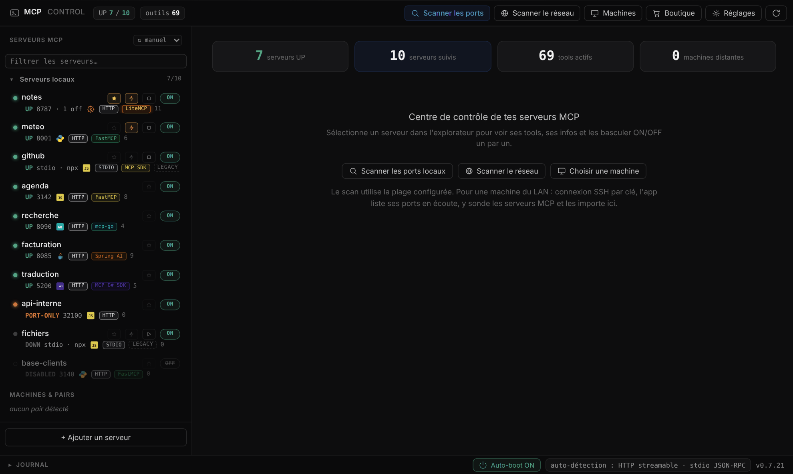
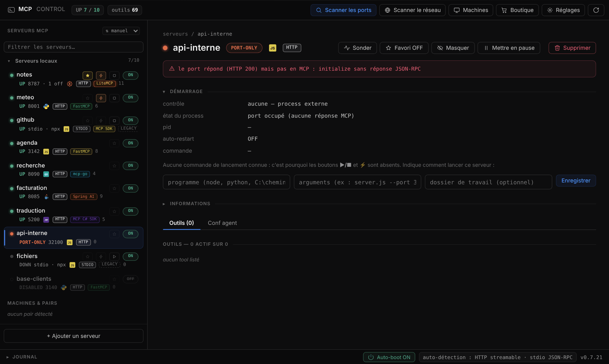
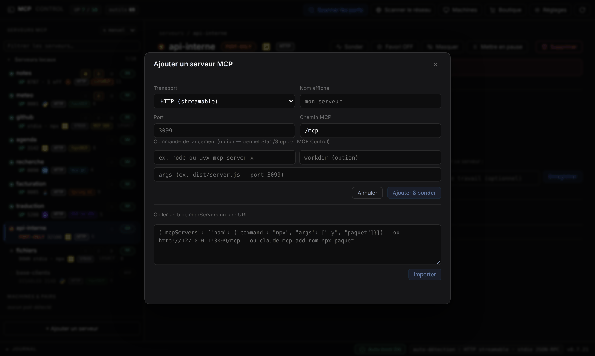
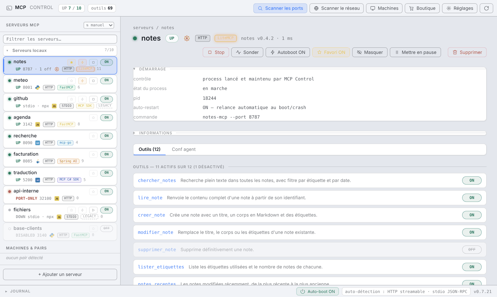

# MCP Control

**Le tableau de bord de tes serveurs MCP.** Il les trouve tout seul, te dit lequel marche et lequel est cassé (et pourquoi), et tout se pilote d'un clic. Ton assistant IA peut aussi s'y brancher et faire ces gestes à ta place.



[Installer](#installer) · [Premiers pas](#premiers-pas) · [Les 4 états](#comprendre-létat-dun-serveur) · [Ce que tu peux faire](#ce-que-tu-peux-faire) · [Brancher ton assistant IA](#brancher-ton-assistant-ia) · [Dépannage](#dépannage) · [Sécurité](#sécurité) · [Limites](#limites) · [Développeurs](#pour-les-développeurs)

## En bref

- **Voir** tous tes serveurs MCP au même endroit, même ceux que tu avais oubliés : l'app balaie les ports de ta machine et reconnaît 38 frameworks.
- **Savoir** tout de suite qui répond, qui est planté, et pour quelle raison.
- **Agir** : démarrer, arrêter, relancer automatiquement, couper un outil précis, installer un nouveau serveur depuis la boutique.
- **Déléguer** : l'app est elle-même un serveur MCP. Un assistant qui s'y connecte peut lister, relancer, installer et appeler les outils de tes serveurs.

Windows, macOS et Linux. Rien à configurer, aucun compte.

## Installer

Télécharge le fichier de ton système sur la [page des releases](https://github.com/DeamonDev888/mcp-control/releases/latest) :

| Système | Fichier |
|---|---|
| **Windows** (installateur) | [`mcp-control-desktop-windows-x86_64-setup.exe`](https://github.com/DeamonDev888/mcp-control/releases/latest/download/mcp-control-desktop-windows-x86_64-setup.exe) |
| **macOS** (Intel et Apple Silicon) | [`mcp-control-desktop-macos-universal`](https://github.com/DeamonDev888/mcp-control/releases/latest/download/mcp-control-desktop-macos-universal) |
| **Linux** (x86_64) | [`mcp-control-desktop-linux-x86_64`](https://github.com/DeamonDev888/mcp-control/releases/latest/download/mcp-control-desktop-linux-x86_64) |

- **Windows** : l'installateur ne demande aucun droit administrateur.
- **macOS** : au premier lancement, clic droit sur le fichier → **Ouvrir**.
- **Linux** : `chmod +x` sur le fichier, puis lance-le.
- **Sans fenêtre** : les binaires `mcp-control-cli-*` de la même release lancent seulement le moteur ; l'interface s'ouvre alors dans ton navigateur sur `http://127.0.0.1:5090`.

<details>
<summary><b>Windows affiche « application non reconnue » ?</b></summary>

Les binaires ne sont pas encore signés : SmartScreen ne connaît pas l'éditeur. Trois façons de passer :

1. À l'avertissement : **Informations complémentaires → Exécuter quand même** (une fois par version).
2. Avant de lancer : `Unblock-File .\mcp-control-desktop-windows-x86_64-setup.exe` dans PowerShell.
3. Vérifier le fichier, puis lancer :

```powershell
Get-FileHash .\mcp-control-desktop-windows-x86_64-setup.exe -Algorithm SHA256
# à comparer avec la ligne du même fichier dans SHA256SUMS.txt :
# https://github.com/DeamonDev888/mcp-control/releases/latest/download/SHA256SUMS.txt
```

</details>

## Premiers pas

1. Ouvre l'app. La liste se remplit toute seule.
2. Clique sur un serveur pour voir ses outils, son état, sa version et sa latence.
3. Un serveur manque ? Clique **⟳** (re-sonde tout et cherche sur tous les ports en écoute), ou **+ Ajouter un serveur**.


Fermer la fenêtre ne quitte pas l'app : elle reste dans la zone de notification et continue de surveiller. Pour quitter vraiment : menu de son icône → **Quitter**.

## Comprendre l'état d'un serveur

L'app ne dit pas seulement « ça marche » ou « ça ne marche pas ». Chaque serveur a l'un de ces quatre états :

| État | Le port | Le serveur MCP | Ce que ça veut dire | Quoi faire |
|---|---|---|---|---|
| 🟢 **UP** | ouvert | répond | le dialogue MCP complet a réussi, les outils sont listés | rien |
| 🟠 **PORT-ONLY** | ouvert | ne répond pas | quelque chose écoute sur ce port, mais ne parle pas MCP | trouver qui occupe le port, ou retirer le serveur |
| ⚪ **DOWN** | fermé | ne répond pas | le serveur est arrêté ou a planté | **▶** pour le relancer |
| ⚫ **DISABLED** | — | — | tu l'as mis en pause : l'app ne le sonde plus | **▶ Reprendre** |

PORT-ONLY et DOWN n'appellent pas le même geste, d'où la distinction. Un serveur DOWN se relance. Un serveur PORT-ONLY ne redémarrera pas tant que le port est pris, souvent par un process resté en vie ou par un service qui n'a rien à voir. Le motif exact s'affiche en tête du détail :



À côté du nom, trois badges : le **langage** (logo), le **transport** (`HTTP`, `STDIO`, `WS`) et le **framework** reconnu (`FastMCP`, `LiteMCP`, `rmcp`, `mcp-go`, `Spring AI`…). La liste des 38 frameworks est dans [docs/frameworks.md](docs/frameworks.md).

L'app sonde les serveurs à l'intervalle réglé dans **Réglages → Général** (15 s par défaut, 5 s au minimum). Un serveur lent ou muet ne retarde pas les autres.

<details>
<summary><b>Reproduire les quatre états chez soi</b></summary>

```bash
# UP : un vrai serveur MCP
node examples/test-http-server.js 3166

# PORT-ONLY : un port qui répond, mais pas en MCP
node -e "require('http').createServer((q,s)=>s.end('ok')).listen(32100)"

# DOWN : ajoute un serveur sur le port 32101 et ne le démarre pas
# DISABLED : « Mettre en pause » dans le détail d'un serveur
```

</details>

## Ce que tu peux faire

**Trouver des serveurs**

| Bouton | Effet |
|---|---|
| **⟳** | Re-sonde tout et cherche les nouveaux serveurs sur les ports en écoute |
| **Scanner les ports** | Cherche sur une plage de ports (512 ports au plus par scan) |
| **Scanner le réseau** | Cherche sur les autres machines du réseau local |
| **Machines** | Va chercher les serveurs d'une machine distante par SSH, et détecte les autres MCP Control du réseau |
| **+ Ajouter un serveur** | Ajout à la main, ou collage d'un bloc `mcpServers` ou d'une URL |
| **Boutique** | 63 serveurs MCP prêts à installer |



**Piloter un serveur**

| Bouton | Effet |
|---|---|
| **ON / OFF** | Allumer ou éteindre le serveur |
| **▶ / ■** | Démarrer ou arrêter son programme |
| **⚡ Autoboot** | Le relancer au démarrage de l'app et après un crash |
| **⭐ Favori** | L'épingler en haut de la liste |
| **Mettre en pause** | Le sortir de la surveillance sans le supprimer |
| **Supprimer** | Le retirer de la liste |
| Interrupteur d'un outil | Couper un outil précis sans arrêter le serveur |

**Organiser et régler**

- **Filtre** (`/` ou `Ctrl+K`) : par nom, port, framework ou état. `Échap` efface.
- **Tri** : manuel (glisser-déposer), A→Z, état, port, latence, outils, framework, transport.
- **Journal** (barre du bas) : l'historique de ce qui s'est passé.
- **Auto-boot** (barre du bas) : ouvrir l'app au démarrage de l'ordinateur, réduite dans la zone de notification.
- **Réglages** : intervalle de sondage, plages de scan, accès réseau, notifications (bureau et webhook), thème, réinitialisation.




## Brancher ton assistant IA

L'app expose un vrai serveur MCP sur son propre port (`POST /mcp`, propulsé par [LiteMCP](https://github.com/DeamonDev888/litemcp)). Déclare-le dans ton assistant :

```json
{ "mcpServers": { "mcp-control": { "url": "http://127.0.0.1:5090/mcp" } } }
```

Tu peux alors lui demander « montre-moi mes serveurs MCP », « relance tel serveur », « installe le serveur Filesystem de la boutique » ou « appelle l'outil X du serveur Y ». Tout passe par les mêmes circuits que les boutons : mêmes validations, même journal.

| Groupe | Ce que l'assistant peut faire |
|---|---|
| **Superviser** | lister les serveurs et leur état, lire le détail, les outils, le journal, l'historique des crashs, le catalogue de la boutique |
| **Agir** | rafraîchir, scanner, ajouter, retirer, démarrer, arrêter, régler l'autoboot, couper un outil, importer une configuration, installer depuis la boutique |
| **Relayer** | `call_server_tool` : appeler un outil de n'importe quel serveur HTTP détecté UP |

La liste complète des 30 outils, leurs paramètres et les ressources sont dans [docs/gateway.md](docs/gateway.md).

Les réglages sensibles (code d'accès, exposition au réseau, webhook, réinitialisations) ne sont pas accessibles par ce canal : ils restent des gestes de la fenêtre.

## Dépannage

| Problème | Solution |
|---|---|
| Mon serveur n'apparaît pas | Clique **⟳**. Sinon **+ Ajouter un serveur** avec son port |
| Un « code d'accès » est demandé | Seulement quand tu ouvres l'app depuis une autre machine. Le code est dans `config.json` |
| L'app ne s'ouvre plus | Elle est sans doute déjà dans la zone de notification : clique sur son icône |
| Un serveur ne redémarre pas | L'app réessaie avec des délais croissants (5 s à 5 min), puis s'arrête après 5 échecs d'affilée. Clique **▶** pour réessayer |
| « Moteur injoignable » | Le moteur ne répond plus. La page réessaie toutes les 2 s et le bandeau disparaît dès qu'il revient |
| Tous mes serveurs distants sont DOWN | Un VPN coupe souvent le réseau local : une pastille rouge apparaît dans la barre du Journal. Déconnecte-le ou autorise les connexions LAN |
| Mes serveurs ont disparu | Ils sont peut-être en pause (DISABLED) : **▶ Reprendre** dans leur détail |

## Sécurité

- Par défaut, l'app n'écoute que sur ta machine : rien n'est ouvert vers l'extérieur.
- Si tu l'ouvres au réseau (**Réglages → accès réseau**), un **code d'accès** est exigé des autres machines, pour l'interface comme pour le gateway.
- **Qui a ce code peut lancer un programme sur ta machine** : c'est le principe d'un serveur stdio (`add_server` puis `start_server`). N'ouvre l'app au réseau qu'en connaissance de cause.
- L'app vérifie l'en-tête `Host` et l'origine des requêtes, plafonne leur taille et leur durée, et garde une part des connexions pour ta machine : une rafale venue du réseau ne coupe pas ta fenêtre.
- Les variables d'environnement des serveurs (jetons) ne ressortent jamais par l'API, le gateway ou le journal : seuls leurs noms sont visibles.

## Limites

- Un serveur en `https://` n'est pas sondable (pas de TLS) : passe par un tunnel local.
- Un serveur WebSocket est seulement détecté : il ne passe jamais UP et ne peut pas être relayé.
- Le webhook de notification n'accepte que des URL `http://`.
- Le relais `call_server_tool` ne couvre que les serveurs HTTP détectés UP, pas les serveurs stdio ni ceux joints par SSH.
- Le bouton Installer de la boutique n'a pas de champ pour les jetons : passe par l'API ou par ton assistant (voir [docs/gateway.md](docs/gateway.md)).
- Les binaires ne sont pas signés.
- `config.json` vit à côté de l'exécutable ; la variable d'environnement `MCC_CONFIG` permet de le placer ailleurs.

## Pour les développeurs

<details>
<summary><b>Commander l'app depuis un script</b></summary>

```bash
# tout l'état
curl http://127.0.0.1:5090/api/state

# le détail d'un serveur
curl "http://127.0.0.1:5090/api/detail?id=mon-serveur"

# une action
curl -X POST -H "Content-Type: application/json" \
  -d '{"action":"add","transport":"stdio","label":"mon-mcp","program":"node","args":["dist/index.js"]}' \
  http://127.0.0.1:5090/api/action

# lister les outils du gateway
curl -X POST -H "Content-Type: application/json" \
  -d '{"jsonrpc":"2.0","id":1,"method":"tools/list"}' \
  http://127.0.0.1:5090/mcp
```

</details>

<details>
<summary><b>Compiler soi-même</b></summary>

```bash
cargo build --release -p mcp-control -p mcp-control-desktop
cargo test --lib            # tests unitaires
cargo test --test e2e       # scénarios de bout en bout, sur un vrai moteur
cargo fmt --check && cargo clippy --all-targets -- -D warnings
```

- `target/release/mcp-control-desktop` : la fenêtre de l'app (Tauri)
- `target/release/mcp-control` : le moteur seul, sans fenêtre

</details>

<details>
<summary><b>Où trouver quoi dans le code</b></summary>

| Dossier ou fichier | Rôle |
|---|---|
| `src/lib.rs` | serveur HTTP local (interface, `/api/*`, `/mcp`), contrôle d'accès, boucle de surveillance |
| `src/probe.rs` | sondage des serveurs et lancement des process |
| `src/manage/` | actions, configuration, scans, pairs et SSH, boutique, import, mise à jour |
| `src/runtime.rs` | autoboot, délais de relance, historique des crashs |
| `src/gateway.rs` | le serveur MCP exposé sur `/mcp` |
| `src/ui.rs`, `src/ui/` | l'interface (HTML, `app.js`, `app.css`) |
| `src/frameworks.rs` | reconnaissance des frameworks |
| `desktop/` | la fenêtre Tauri, l'icône de la zone de notification, l'installateur Windows |
| `tests/e2e/`, `examples/` | scénarios de bout en bout et faux serveurs MCP de test |

</details>

L'historique des versions est dans [CHANGELOG.md](CHANGELOG.md).

## Licence

Double licence **MIT ou Apache-2.0**, au choix : [`LICENSE-MIT`](LICENSE-MIT), [`LICENSE-APACHE`](LICENSE-APACHE).

<sub>Les captures d'écran sont faites avec des serveurs de démonstration.</sub>
